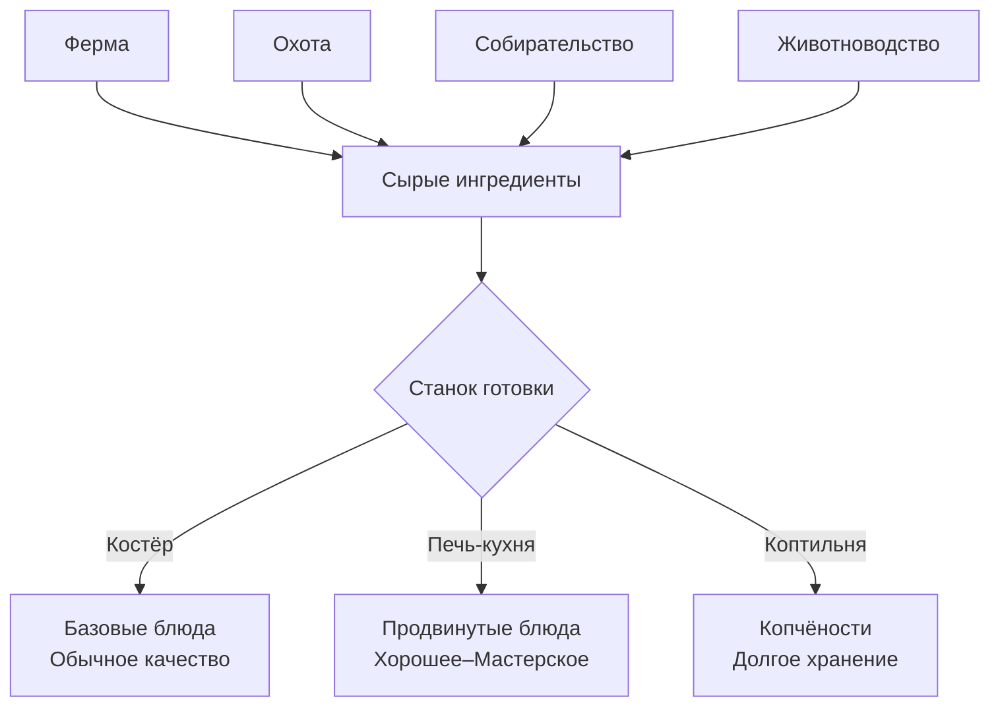

# After The Storm — Мастер-план развития игры

> **Версия:** 1.0 · **Дата:** 12.10.2026
> **Текущее состояние:** Глава 1 «Base Restored» завершена (14 этапов, 42 теста)
> **Движок:** Godot 4.7.2 · **Язык:** GDScript 2.0

---

## Оглавление

1. [Предыстория и сюжетная канва](#1-предыстория-и-сюжетная-канва)
2. [Глава 2 — «Первый дым» (Основы кулинарии и костёр)](#2-глава-2--первый-дым)
3. [Глава 3 — «Соседи» (NPC, торговля и расширение фермы)](#3-глава-3--соседи)
4. [Глава 4 — «Охотник» (Фауна, охота и животноводство)](#4-глава-4--охотник)
5. [Глава 5 — «Мастер» (Промышленность и автоматизация)](#5-глава-5--мастер)
6. [Глава 6 — «Возрождение» (Восстановление деревни, финал)](#6-глава-6--возрождение)
7. [Система кулинарии (сквозная)](#7-система-кулинарии-сквозная)
8. [Расширение фермы (сквозное)](#8-расширение-фермы-сквозное)
9. [Система сезонов и погоды](#9-система-сезонов-и-погоды)
10. [Новые машины и станки](#10-новые-машины-и-станки)
11. [Новые персонажи (NPC)](#11-новые-персонажи-npc)
12. [Улучшения существующих механик](#12-улучшения-существующих-механик)
13. [Технический план реализации](#13-технический-план-реализации)

---

## 1. Предыстория и сюжетная канва

### Завязка

Сильнейший ураган «Буревал» прокатился по долине и разрушил деревню **Тихая Заводь** — два десятка дворов, мельницу, кузницу, общинный склад и мост через овраг. Главный герой — **мастер-снабженец**, живущий на окраине. До бури он содержал мастерскую и небольшое хозяйство: поставлял деревне дрова, кирпич, строительные материалы и продукты с фермы. Ураган уничтожил его станки, дом и склад. В руинах остались лишь **костёр** из обломков и **старый верстак**, переживший удар чудом.

### Сюжетная дуга по главам

| Глава | Название | Основная тема | Финальная веха |
|---|---|---|---|
| 1 ✅ | Base Restored | Базовое выживание и восстановление мастерской | 8 вех: дом, склад, станки, ферма, энергосеть |
| 2 | Первый дым | Костёр, готовка, первые блюда, грибы | Печь-кухня построена, 5 блюд приготовлены |
| 3 | Соседи | Новые NPC, расширенная ферма, торговые пути | Рынок открыт, 3 NPC обслужены, 6 культур выращены |
| 4 | Охотник | Дикие животные, охота, мясо, кожа, животноводство | Курятник / загон построены, 3 вида мяса добыты |
| 5 | Мастер | Лесопилка, токарный, автоматизация, электрика Lv.2 | Промышленная зона работает, станки Lv.3 |
| 6 | Возрождение | Восстановление деревни, мост, мельница, кузница | Деревня восстановлена, финал игры |

### Мотивация героя

Каждая глава раскрывает новый аспект мотивации:
- **Гл. 1:** Выживание — «Мне нужна крыша и стены, иначе не переживу зиму»
- **Гл. 2:** Комфорт — «Сырые овощи и ягоды — не жизнь. Нужен горячий обед»
- **Гл. 3:** Связи — «Я не один. Соседи выжили, и мы можем помогать друг другу»
- **Гл. 4:** Освоение — «В лесу есть дичь и опасности. Пора стать охотником»
- **Гл. 5:** Мастерство — «Ручной труд — прошлый век. Время строить настоящее производство»
- **Гл. 6:** Ответственность — «Деревня ждёт. Я — тот, кто её восстановит»

---

## 2. Глава 2 — «Первый дым»

> **Новый стартовый баланс:** в начале игры доступны только **Костёр** и **Верстак**. Дробилка, плавильня и фильтр — ремонтируются по мере прогресса (как дом и склад в Главе 1).

### 2.1 Костёр (новый станок — стартовый)

Примитивная точка готовки и обогрева. Доступен с первого дня.

| Свойство | Значение |
|---|---|
| Энергопотребление | 0 (ручной) |
| Топливо | дрова (15 с), уголь (90 с), брикет (120 с) — 1 слот |
| Рецепты | 6 базовых блюд + обжарка + сушка |
| Особенность | Сушит одежду (как печь), даёт свет ночью |

**Рецепты костра:**

| Рецепт | Вход | Выход | Время | Эффект еды |
|---|---|---|---|---|
| Печёный картофель | 2 картофеля | 2 печёного картофеля | 30 с | +55% сытости, +20 энергии |
| Жареная морковь | 3 моркови, 1 вода | 2 жареной моркови | 25 с | +35% сытости, +18% жажды, +12 энергии |
| Овощной суп | 1 морковь, 1 картофель, 2 воды | 2 супа | 45 с | +50% сытости, +30% жажды, +15 энергии |
| Ягодный отвар | 4 красных ягоды, 1 вода | 2 ягодного отвара | 20 с | +20% жажды, +15 энергии, +5 здоровья |
| Грибная похлёбка | 2 гриба, 1 вода | 2 похлёбки | 35 с | +40% сытости, +25% жажды, +10 энергии |
| Сушёные грибы | 3 гриба | 2 сушёных гриба | 40 с | Лёгкие, долго хранятся, +25% сытости |
| Жареное мясо *(Гл. 4)* | 1 сырое мясо | 1 жареное мясо | 30 с | +60% сытости, +25 энергии |
| Кипячёная вода | 2 сырой воды | 2 чистой воды | 20 с | Альтернатива фильтру |

### 2.2 Грибы (новый ресурс)

| Параметр | Значение |
|---|---|
| Предмет | `mushroom` — «Лесной гриб» 🍄 |
| Где растёт | Тенистые места у деревьев и камней, влажные зоны |
| Респаун | 18 игровых часов |
| Сезон | Лето, осень (когда сезоны заработают) |
| Сырой | Съедобен (+12% сытости, +5 энергии), но слаб |

Грибы — **первый ингредиент кулинарии**, доступный без фермы. Мотивация осматривать мир.

### 2.3 Ремонт станков (новая механика)

Дробилка, плавильня и фильтр воды — **разрушены** и ремонтируются как здания:

| Станок | Стоимость ремонта | Что даёт |
|---|---|---|
| Дробилка | 10 камня, 4 дерева, 50 кр. | Камень → пыль, дерево → опилки |
| Плавильня | 15 кирпичей, 6 камня, 2 глины, 80 кр. | Обжиг, выплавка, выпечка |
| Фильтр воды | 8 песка, 4 дерева, 30 кр. | Фильтрация воды |

### 2.4 Вехи Главы 2

1. ☐ Приготовить 5 разных блюд на костре
2. ☐ Найти и собрать 10 грибов
3. ☐ Отремонтировать дробилку
4. ☐ Отремонтировать плавильню
5. ☐ Построить **Печь-кухню** (улучшенный станок готовки)

---

## 3. Глава 3 — «Соседи»

### 3.1 Новые NPC

| NPC | Роль | Где появляется | Триггер |
|---|---|---|---|
| **Марта** — фермерша | Продаёт семена экзотических культур и саженцы фруктов | У фермы, после ремонта дома (ст. 2+) | Глава 3, начало |
| **Кузнец Игорь** | Чинит инструменты до полной прочности, продаёт чертежи | У наковальни (строится) | После 5 заказов |
| **Лесничий Фёдор** | Даёт охотничьи задания, продаёт ловушки | На опушке леса | Глава 4 |

### 3.2 Торговый рынок

Новое здание на базе — **Торговая лавка** (ремонтируется как дом/склад):

| Стадия | Что даёт |
|---|---|
| 0 — Развалины | Прилавок со щитом «Закрыто» |
| 1 — Навес | Степан торгует: покупает и продаёт базовые предметы |
| 2 — Лавка | Расширенный ассортимент, заказы от путешественников |
| 3 — Рынок | Марта торгует семенами, Игорь — чертежами, табло цен |

### 3.3 Расширение фермы: новые культуры (Глава 3)

| Культура | Рост (ч) | Влага | Урожай | Сезон | Откуда семена |
|---|---|---|---|---|---|
| 🌻 Подсолнух | 20 | 25–65% | 2–4 семечки | лето | Марта, 20 кр. |
| 🧅 Лук | 14 | 35–75% | 3–5 луковиц | весна–осень | Марта, 15 кр. |
| 🥬 Капуста | 26 | 40–85% | 1–2 кочана | лето, осень | Марта, 25 кр. |
| 🍅 Помидор | 18 | 50–90% | 3–6 шт. | лето | Марта, 30 кр. |
| 🫑 Перец | 22 | 35–70% | 2–4 шт. | лето | Марта, 35 кр. |
| 🫘 Фасоль | 12 | 30–65% | 4–8 стручков | весна, лето | Марта, 12 кр. |
| 🌿 Травы (укроп/петрушка) | 8 | 30–70% | 3–6 пучков | весна–осень | Марта, 8 кр. |

### 3.4 Фруктовые деревья (долгосрочные)

Новая механика: **фруктовые саженцы** — сажаются на свободную землю, растут несколько игровых дней, потом дают урожай каждый сезон.

| Дерево | Рост до первого урожая | Урожай | Сезон сбора |
|---|---|---|---|
| 🍎 Яблоня | 3 игровых дня | 4–8 яблок | Осень |
| 🍐 Груша | 4 игровых дня | 3–6 груш | Осень |
| 🍒 Вишня | 3 дня | 6–12 вишен | Лето |

Фрукты — ингредиенты для десертов, компотов и джемов (рецепты кухни).

### 3.5 Контракты Главы 3 (новые волны)

| Волна | Заказ | Требования | Награда |
|---|---|---|---|
| 4 (после 4 заказов) | Горячие обеды для рабочих | 6 овощных супов, 4 хлеба | 350 кр. |
| 4 | Поставка семян для посёлка | 10 семян моркови, 8 семян пшеницы, 4 семенного картофеля | 280 кр. |
| 5 (после 6) | Заготовки на зиму | 8 сушёных грибов, 4 бутилир. воды, 6 хлеба | 420 кр. |
| 5 | Медикаменты | 4 целебной воды, 6 ягодного отвара | 500 кр. |

---

## 4. Глава 4 — «Охотник»

### 4.1 Дикая фауна

| Животное | Поведение | Здоровье | Добыча | Где встречается |
|---|---|---|---|---|
| 🐰 Заяц | Убегает при приближении | 15 | 1 сырое мясо, 1 шкура | Луга, опушки |
| 🦌 Олень | Убегает быстро | 40 | 3 сырого мяса, 2 шкуры, 1 рог | Лес, дальние поляны |
| 🐗 Кабан | Агрессивен при приближении | 60 | 4 сырого мяса, 2 шкуры, 1 клык | Чаща, у корней |
| 🐺 Волк *(угроза)* | Агрессивен, стая 2–3 | 35 | 1 шкура, 1 клык | Ночь, дальний лес |
| 🐟 Рыба *(удочка)* | Мини-игра «ожидание + подсечка» | — | 1–3 рыбы | Река / пруд |

### 4.2 Новые инструменты

| Инструмент | Рецепт (верстак) | Назначение |
|---|---|---|
| 🏹 Лук | 3 дерева, 2 ткани, 1 ремень | Дистанционная охота |
| 🪤 Ловушка | 2 дерева, 2 болта, 1 ремень | Пассивная добыча зайцев |
| 🎣 Удочка | 2 дерева, 1 медный провод, 1 болт | Рыбалка |

### 4.3 Новые предметы

| Предмет | Категория | Описание |
|---|---|---|
| `raw_meat` — Сырое мясо 🥩 | food (сырая) | Нельзя есть сырым, нужно приготовить |
| `hide` — Шкура 🟫 | resource | Для кожи, одежды, мебели |
| `leather` — Кожа 🟤 | material | Выделанная шкура (верстак) |
| `horn` — Рог 🦌 | resource | Декор, компоненты, продажа |
| `tusk` — Клык 🐗 | resource | Оружие, украшения, продажа |
| `fish` — Свежая рыба 🐟 | food (сырая) | Для жарки, ухи, копчения |
| `arrow` — Стрела ↗️ | ammo | 1 дерево + 1 камень → 4 стрелы |
| `cooked_meat` — Жареное мясо 🍖 | food | +60% сытости, +25 энергии |
| `stew` — Рагу 🍲 | food | +70% сытости, +30% жажды, +20 энергии |
| `fish_soup` — Уха 🐟🍜 | food | +45% сытости, +40% жажды, +15 энергии, +8 здоровья |
| `smoked_meat` — Копчёное мясо 🥓 | food | +50% сытости, +30 энергии. Не портится |
| `smoked_fish` — Копчёная рыба 🐟 | food | +35% сытости, +20 энергии. Не портится |

### 4.4 Животноводство (поздняя Глава 4)

Строящиеся загоны — новый тип зданий:

| Строение | Стоимость | Вмещает | Продукция |
|---|---|---|---|
| 🐔 Курятник | 12 дерева, 6 камня, 2 ткани | 4 курицы | 1–2 яйца / игровой день |
| 🐄 Загон | 20 дерева, 10 камня, 4 ткани, 4 болта | 2 коровы | 1 молоко / игровой день |

Куриц и корову **покупаем у Марты** после постройки загонов.

| Предмет | Эффект |
|---|---|
| `egg` — Яйцо 🥚 | Ингредиент для выпечки и омлета |
| `milk` — Молоко 🥛 | Ингредиент для масла, сыра, каши |

### 4.5 Вехи Главы 4

1. ☐ Скрафтить лук и стрелы
2. ☐ Добыть 3 вида мяса (заяц, олень, кабан)
3. ☐ Поймать рыбу
4. ☐ Приготовить рагу и копчёное мясо
5. ☐ Построить курятник или загон
6. ☐ Собрать 10 яиц или 5 молока

---

## 5. Глава 5 — «Мастер»

### 5.1 Новые станки

| Станок | Стоимость постройки | Назначение | Энерго |
|---|---|---|---|
| 🪚 **Лесопилка** | 15 дерева, 8 слитков, 4 шестерни, 4 болта | Дерево → доски, балки | 4.0 кВт |
| 🔧 **Токарный станок** | 10 слитков, 6 шестерён, 4 пластины, 100 кр. | Точные детали, трубы, оси | 3.5 кВт |
| 🍳 **Кухня** | 12 кирпичей, 6 пластин, 4 стекла, 2 дерева | Продвинутая готовка с рецептами | 2.0 кВт |
| 🏭 **Коптильня** | 8 кирпичей, 6 дерева, 2 пластины | Копчение мяса и рыбы | 0 (дрова) |
| 🧵 **Ткацкий станок** | 8 дерева, 4 болта, 2 шестерни | Продвинутая ткань, одежда | 1.5 кВт |
| 🫒 **Маслобойня** | 6 камня, 4 дерева, 2 шестерни | Семечки → масло, молоко → масло/сыр | 1.0 кВт |

### 5.2 Рецепты лесопилки

| Рецепт | Вход | Выход | Время |
|---|---|---|---|
| Распил: Доски | 2 дерева | 4 доски | 25 с |
| Распил: Балки | 3 дерева | 2 балки | 35 с |
| Шлифовка: Мебельная доска | 2 доски | 1 мебельная доска | 30 с |

### 5.3 Рецепты кухни (продвинутые)

| Рецепт | Вход | Выход | Эффект |
|---|---|---|---|
| Овощное рагу ★ | 1 картофель, 1 морковь, 1 лук, 1 масло | 3 рагу | +70% сытости, +30% жажды, +20 энергии |
| Борщ | 1 капуста, 1 картофель, 1 морковь, 1 лук, 2 воды | 3 борща | +80% сытости, +35% жажды, +25 энергии |
| Пирог с мясом | 2 пшеницы, 2 мяса, 1 лук, 1 яйцо | 2 пирога | +90% сытости, +40 энергии |
| Ягодное варенье | 6 ягод (любых), 1 стекло | 2 варенья | +15% сытости, +15 энергии, +10 здоровья |
| Фруктовый компот | 4 яблока/груши, 2 воды, 1 стекло | 3 компота | +25% жажды, +20 энергии, +5 здоровья |
| Яичница с овощами | 2 яйца, 1 помидор, 1 перец, 1 масло | 2 яичницы | +55% сытости, +20 энергии |
| Сыр | 3 молока | 2 сыра | +45% сытости, +35 энергии |
| Масло | 3 семечек подсолнуха ИЛИ 2 молока | 1 масло | Ингредиент для блюд |
| Пшённая каша | 2 пшеницы, 1 молоко, 1 вода | 2 каши | +50% сытости, +30% жажды, +15 энергии |

### 5.4 Система «Качество блюда»

Блюда, приготовленные на **кухне** (а не на костре), получают бонус качества:
- **Обычное** (костёр): базовые характеристики
- **Хорошее** (кухня Lv.1): +20% ко всем эффектам
- **Отличное** (кухня Lv.2+): +40% ко всем эффектам, бонус к здоровью
- **Мастерское** (кухня Lv.3 + Фермер): +60% ко всем эффектам

### 5.5 Промышленная энергосеть

| Улучшение | Стоимость | Эффект |
|---|---|---|
| Ветряк Lv.2 | 8 стальных пластин, 6 точных шестерён, 4 провода | 5.0–17.0 кВт |
| Батарея Lv.2 | 6 элементов, 4 стальных пластины | 250 кВт·ч |
| Солнечная панель *(Lv.3)* | 6 стекла, 4 провода, 2 стальных пластины | 3.0 кВт днём |

### 5.6 Вехи Главы 5

1. ☐ Построить лесопилку
2. ☐ Построить кухню
3. ☐ Приготовить 3 продвинутых блюда на кухне
4. ☐ Улучшить ветряк до Lv.2
5. ☐ Все станки на базе минимум Lv.2
6. ☐ Произвести 10 досок и 4 балки

---

## 6. Глава 6 — «Возрождение»

### 6.1 Восстановление деревни

Деревня **Тихая Заводь** — локация за мостом (мост — первый объект ремонта). После восстановления моста открываются руины деревни.

| Объект | Стоимость | Этапов ремонта | Что даёт |
|---|---|---|---|
| 🌉 Мост | 20 балок, 30 досок, 10 болтов, 8 стальных пластин | 2 | Доступ к деревне |
| 🏠 Дома жителей (×4) | 15 досок, 10 кирпичей, 4 стекла, 6 раствора каждый | 2 | Жители возвращаются, новые NPC |
| ⚒️ Кузница | 20 обожж. кирпичей, 12 слитков, 6 шестерён | 3 | Ковка Lv.3, рецепты стали |
| 🌾 Мельница | 15 досок, 8 балок, 4 шестерни, 6 камня | 3 | Автоматический помол муки |
| 🏛️ Ратуша | 30 обожж. кирпичей, 20 досок, 12 стёкол, 8 стальных пластин | 4 | Финальное здание |

### 6.2 Новые NPC деревни

| NPC | Роль | Появляется после |
|---|---|---|
| **Староста Пётр** | Даёт глобальные квесты на восстановление, торгует чертежами | Мост + 1 дом |
| **Пекарь Анна** | Покупает муку, яйца, масло; продаёт редкие рецепты | Мельница |
| **Доктор Ольга** | Покупает целебную воду, травы; продаёт лечебные зелья | 2 дома |
| **Охотник Василий** | Обменивает шкуры на редкие материалы | Кузница |

### 6.3 Финальные контракты

| Заказ | Требования | Награда | От кого |
|---|---|---|---|
| Пир восстановления | 10 пирогов, 6 борщей, 8 компотов, 4 варенья | 1200 кр. | Староста |
| Оснащение кузницы | 10 стальных слитков, 8 точных шестерён, 6 стальных пластин | 1500 кр. | Кузнец Игорь |
| Электрификация деревни | 12 фонарей, 8 проводов, 4 элемента | 1800 кр. | Староста |
| Зимний запас | 20 копчёного мяса, 15 сушёных грибов, 10 варенья, 8 компотов | 2000 кр. | Пекарь Анна |

### 6.4 Финал: «Возрождение»

Ратуша восстановлена → кат-сцена: жители собираются на площади, Степан произносит речь, камера облетает восстановленную деревню. Экран **«ТИХАЯ ЗАВОДЬ ВОЗРОЖДЕНА»**.

---

## 7. Система кулинарии (сквозная)

### 7.1 Принципы дизайна

> [!IMPORTANT]
> **Правило:** готовая еда **всегда лучше** сырых ингредиентов по сумме эффектов. Это мотивирует строить кулинарную цепочку, а не просто есть картошку с грядки.

### 7.2 Категории блюд

| Категория | Примеры | Особенность |
|---|---|---|
| **Лёгкая закуска** | Печёный картофель, жареная морковь | Быстро, мало ингредиентов |
| **Суп / похлёбка** | Овощной суп, уха, борщ | Утоляет жажду + сытость |
| **Горячее блюдо** | Рагу, пирог, яичница | Высокая сытость + энергия |
| **Выпечка** | Хлеб, пирог, булочки | Макс. сытость, нужна мука |
| **Напиток** | Ягодный отвар, компот, молоко | Жажда + здоровье |
| **Консервы** | Копчёное мясо, сушёные грибы, варенье | Не портятся, экспедиционная еда |

### 7.3 Прогрессия по станкам

| Станок | Когда | Рецепты | Качество |
|---|---|---|---|
| Костёр | С начала | Жарка, варка, сушка, кипячение | Обычное |
| Плавильня (хлеб) | Глава 1 | Только хлеб | Обычное |
| Печь-кухня | Глава 2–3 | Супы, каши, жарка с маслом | Хорошее |
| Кухня | Глава 5 | Все рецепты, составные блюда | Хорошее–Мастерское |
| Коптильня | Глава 4 | Копчение мяса и рыбы | — (консервация) |

### 7.4 Баланс: сравнение еды

| Еда | Сытость | Жажда | Энергия | Здоровье | Доступность |
|---|---|---|---|---|---|
| Сырая морковь | 28% | 12% | +10 | — | Грядка, Гл.1 |
| Жареная морковь | 35% | 18% | +12 | — | Костёр, Гл.2 |
| Овощной суп | 50% | 30% | +15 | — | Костёр, Гл.2 |
| Борщ (кухня) | 80% | 35% | +25 | — | Кухня, Гл.5 |
| Хлеб | 65% | — | +25 | — | Печь, Гл.1 |
| Пирог с мясом | 90% | — | +40 | — | Кухня, Гл.5 |
| Копчёное мясо | 50% | — | +30 | — | Коптильня, Гл.4 |
| Ягодное варенье | 15% | — | +15 | +10 | Кухня, Гл.5 |

---

## 8. Расширение фермы (сквозное)

### 8.1 Все культуры по главам

| Глава | Культура | Рост (ч) | Урожай | Применение |
|---|---|---|---|---|
| 1 ✅ | 🥕 Морковь | 10 | 2–3 | Еда, жарка, суп, борщ |
| 1 ✅ | 🥔 Картофель | 16 | 2–4 | Еда, печёный, суп, борщ, рагу |
| 1 ✅ | 🌾 Пшеница | 22 | 3–5 | Хлеб, мука, ткань, семена, каша |
| 3 | 🌻 Подсолнух | 20 | 2–4 | Масло |
| 3 | 🧅 Лук | 14 | 3–5 | Суп, борщ, рагу, пирог |
| 3 | 🥬 Капуста | 26 | 1–2 | Борщ, щи, засолка |
| 3 | 🍅 Помидор | 18 | 3–6 | Суп, соус, яичница |
| 3 | 🫑 Перец | 22 | 2–4 | Яичница, рагу, приправа |
| 3 | 🫘 Фасоль | 12 | 4–8 | Суп, гарнир, экспорт |
| 3 | 🌿 Травы | 8 | 3–6 | Приправа (+качество), отвары, лечебные |
| 5 | 🌽 Кукуруза | 24 | 2–4 | Каша, корм, масло |
| 5 | 🍉 Тыква | 30 | 1–2 | Каша, пирог, суп |

### 8.2 Фруктовые деревья

| Дерево | Рост | Сезон | Урожай/сезон | Применение |
|---|---|---|---|---|
| 🍎 Яблоня | 3 дня | Осень | 4–8 | Компот, варенье, пирог |
| 🍐 Груша | 4 дня | Осень | 3–6 | Компот, варенье |
| 🍒 Вишня | 3 дня | Лето | 6–12 | Варенье, компот, пирог |

### 8.3 Ягоды (существующие + новые)

| Куст | Ягода | Урожай | Сезон | Применение |
|---|---|---|---|---|
| ✅ Красный | Красная ягода | 3 | Весна, лето | Еда, отвар, варенье |
| ✅ Синий | Синяя ягода | 6 | Зима | Еда, отвар, варенье |
| 🆕 Ежевика | Ежевика | 4 | Лето, осень | Варенье, пирог, компот |
| 🆕 Облепиха | Облепиха | 8 | Осень | Масло, лечебный настой (+здоровье) |

---

## 9. Система сезонов и погоды

### 9.1 Сезонный цикл

> [!NOTE]
> Сейчас `Seasons.current_season == ""` — заглушка. Предлагается активировать систему с Главы 3.

| Сезон | Длительность (игр. дни) | Температура | Дождь | Особенности |
|---|---|---|---|---|
| 🌱 Весна | 7 | Умеренно | Часто | Посадка, высокая влажность |
| ☀️ Лето | 7 | Жарко | Редко | Макс. солнце, засуха возможна |
| 🍂 Осень | 7 | Прохладно | Часто | Урожай фруктов, грибы |
| ❄️ Зима | 7 | Холодно | Снег | Замедленный рост, синие ягоды, охота |

Полный год = 28 игровых дней ≈ 28 × 24 мин = ~11 часов реального времени.

### 9.2 Сезонные эффекты

- **Зима:** Персонаж мёрзнет на улице без одежды (-здоровье/ч), огонь/дом обязательны; вода в открытых источниках замёрзла — нужен колодец
- **Лето:** Засуха — грядки сохнут вдвое быстрее, нужен больше полив
- **Осень:** Грибы × 2, фруктовый урожай, листопад (визуал)
- **Весна:** Всё растёт × 1.3, дожди поливают автоматически

### 9.3 Погодные события

| Событие | Сезон | Эффект | Длительность |
|---|---|---|---|
| Гроза | Весна, Лето | Сильный дождь, возможен удар молнии (поджог дерева) | 2–6 ч |
| Засуха | Лето | Нет дождя 3+ дня, грядки сохнут ×3 | 3–5 дней |
| Метель | Зима | Замедление, урон от холода ×2, видимость ↓ | 4–12 ч |
| Ураган *(редко)* | Осень | Повреждение забора/крыши (1 стадия), ресурсы разбросаны | 2–4 ч |

---

## 10. Новые машины и станки

### Сводная таблица всех станков по главам

| Станок | Глава | Тип | Уровни | Основные рецепты |
|---|---|---|---|---|
| ✅ Верстак | 1 | Сборка | 1–3 | Компоненты, инструменты |
| ✅ Дробилка | 1→2 | Измельчение | 1–3 | Пыль, опилки |
| ✅ Плавильня | 1→2 | Термообработка | 1–3 | Кирпич, стекло, слитки, хлеб |
| ✅ Фильтр воды | 1→2 | Очистка | 1–3 | Вода чистая, целебная |
| 🆕 Костёр | 2 (старт) | Готовка/обогрев | — | Базовые блюда, сушка, кипячение |
| 🆕 Печь-кухня | 2 | Готовка | 1–2 | Средние блюда, соусы |
| 🆕 Коптильня | 4 | Консервация | 1–2 | Копчёности |
| 🆕 Лесопилка | 5 | Деревообработка | 1–3 | Доски, балки, мебельные |
| 🆕 Токарный станок | 5 | Металлообработка | 1–3 | Трубы, оси, точные детали |
| 🆕 Кухня | 5 | Продвинутая готовка | 1–3 | Все рецепты еды |
| 🆕 Ткацкий станок | 5 | Текстиль | 1–2 | Ткань Lv.2, одежда |
| 🆕 Маслобойня | 5 | Переработка | 1–2 | Масло из семечек/молока, сыр |
| 🆕 Колодец | 3 | Водоснабжение | — | Бесконечная сырая вода, зимой работает |
| 🆕 Мельница *(деревня)* | 6 | Помол | 1–2 | Пшеница → мука (автомат) |

---

## 11. Новые персонажи (NPC)

### Сводка всех NPC по главам

| NPC | Глава | Роль | Особенность |
|---|---|---|---|
| ✅ Караванщик Степан | 1 | Торговец, заказчик | Волны контрактов, стартовые семена |
| 🆕 Фермерша Марта | 3 | Торговка семенами | Экзотические культуры, саженцы фруктов, животные |
| 🆕 Кузнец Игорь | 3 | Ремонт, чертежи | Чинит инструменты, продаёт рецепты Lv.3 |
| 🆕 Лесничий Фёдор | 4 | Охотничьи квесты | Продаёт ловушки, учит охоте |
| 🆕 Рыбак Семён | 4 | Рыболовные квесты | Появляется у реки, продаёт наживку |
| 🆕 Староста Пётр | 6 | Глобальные квесты | Восстановление деревни |
| 🆕 Пекарь Анна | 6 | Торговка продуктами | Покупает муку/яйца, продаёт рецепты |
| 🆕 Доктор Ольга | 6 | Лечение, зелья | Целебные зелья, лекарства |

### Диалоговая система (улучшение)

Каждый NPC имеет:
- **Приветствие** — зависит от прогресса и сезона
- **Торговлю** — покупка/продажа специализированных товаров
- **Квесты** — 2–4 задания, привязанных к специализации
- **Реплики** — комментарии к погоде, времени суток, прогрессу

---

## 12. Улучшения существующих механик

### 12.1 Система прочности инструментов

> [!TIP]
> Инструменты ломаются после N использований. Ремонт у кузнеца Игоря или на верстаке.

| Инструмент | Прочность Lv.1 | Прочность Lv.2 | Ремонт |
|---|---|---|---|
| Топор | 80 ударов | 150 ударов | 1 дерево + 1 болт |
| Кирка | 60 ударов | 120 ударов | 1 камень + 1 болт |
| Лопата | 100 ударов | 200 ударов | 1 дерево |
| Ведро | Не ломается | Не ломается | — |

### 12.2 Система одежды

Новая категория предметов `clothing`:

| Одежда | Рецепт | Эффект |
|---|---|---|
| Шапка | 2 ткани | Защита от холода +15% |
| Куртка | 4 ткани, 2 кожи | Защита от холода +40%, от дождя +20% |
| Сапоги | 2 кожи, 2 болта | Скорость +10%, защита от грязи |
| Перчатки | 1 кожа, 1 ткань | Добыча +10%, защита рук |

### 12.3 Система температуры

Расширение существующей системы мокроты:

| Фактор | Эффект |
|---|---|
| Мороз (зима, ночь) | -здоровье/ч без одежды/огня |
| Жара (лето, полдень) | +жажда ×1.5 |
| Одежда | Снижает урон от холода |
| Костёр/печь рядом | Убирает холод, сушит |

### 12.4 Система мебели (декор базы)

Новая категория для домашнего уюта:

| Мебель | Рецепт | Бонус |
|---|---|---|
| Кровать | 4 доски, 2 ткани | Сон ×1.5 эффективнее |
| Стол | 4 доски | Еда даёт +10% бонуса (за столом) |
| Полки | 3 доски, 2 болта | +4 слота к складу |
| Сундук | 6 досок, 4 болта, 2 пластины | Внешнее хранилище, 20 слотов |

### 12.5 Улучшение специализаций

| Класс | Бонус Глава 1 ✅ | Новый бонус (Гл. 3+) |
|---|---|---|
| ⛏ Шахтёр | +1 руда/уголь, −20% энергии | +15% прочность инструментов, видит жилы издалека |
| 🌾 Фермер | Рост ×1.35 | Качество еды +1 категория, урожай +20% |
| 🔬 Учёный | Станки ×1.4 быстрее | Рецепты Lv.3 дешевле на 25%, новые рецепты |

---

## 13. Технический план реализации

### 13.1 Порядок реализации

```mermaid
gantt
    title Порядок реализации глав
    dateFormat X
    axisFormat %s
    
    section Подготовка
    Активация системы сезонов     :a1, 0, 2
    Костёр (новый станок)         :a2, 0, 3
    Грибы (новый ресурс)          :a3, 1, 2
    
    section Глава 2
    Рецепты костра                :b1, 3, 3
    Ремонтируемые станки          :b2, 3, 4
    Печь-кухня                    :b3, 5, 3
    Вехи и тесты                  :b4, 7, 2
    
    section Глава 3
    NPC Марта                     :c1, 9, 3
    Новые культуры                :c2, 9, 4
    Торговая лавка                :c3, 11, 3
    Колодец                       :c4, 12, 2
    
    section Глава 4
    Фауна и AI                   :d1, 14, 5
    Лук и стрелы                  :d2, 14, 3
    Коптильня                     :d3, 17, 3
    Животноводство                :d4, 19, 4
```

### 13.2 Затрагиваемые файлы

| Система | Файлы для изменения/создания |
|---|---|
| Предметы | `scripts/inventory/item_db.gd` — новые записи |
| Рецепты | `scripts/crafting/recipe_db.gd` — новые рецепты |
| Контракты | `scripts/economy/contract_db.gd` — новые волны |
| Культуры | `scripts/farming/crop_db.gd` — новые культуры |
| Сезоны | `scripts/core/seasons.gd` — активация заглушки |
| Костёр | **НОВЫЙ** `scripts/crafting/campfire.gd` |
| NPC | **НОВЫЙ** `scripts/npc/npc_db.gd` — база всех NPC |
| Фауна | **НОВЫЙ** `scripts/world/wildlife.gd` |
| Охота | **НОВЫЙ** `scripts/player/hunting.gd` |
| Животноводство | **НОВЫЙ** `scripts/farming/animal_pen.gd` |
| Кулинария | **НОВЫЙ** `scripts/crafting/cooking_quality.gd` |
| Температура | `scripts/player/player.gd` — расширение |
| Одежда | `scripts/inventory/equipment.gd` — **НОВЫЙ** |
| Мебель | `scripts/buildings/furniture.gd` — **НОВЫЙ** |

### 13.3 Принципы при реализации

> [!IMPORTANT]
> 1. **Каждая глава — отдельная ветка Git** с полным набором тестов
> 2. **Документация обновляется в том же коммите** (`docs/DOCUMENTATION.md`)
> 3. **Обратная совместимость сохранений** — новые поля опциональны
> 4. **Баланс тестируется** — `test_progression_balance.gd` расширяется

### 13.4 Сохранения — новые секции

| Секция | Глава | Содержимое |
|---|---|---|
| `campfire` | 2 | Состояние костра, топливо |
| `cooking` | 2 | Рецепты, качество |
| `seasons` | 3 | Текущий сезон, день в сезоне |
| `market` | 3 | Стадия лавки, инвентарь NPC |
| `wildlife` | 4 | Состояние животных, респаун |
| `animal_pens` | 4 | Загоны, животные, продукция |
| `village` | 6 | Стадии зданий деревни |

---

> [!NOTE]
> Этот документ — живой план. При начале работы над конкретной главой
> создаётся детальный технический документ с кодовыми сниппетами,
> точными числами баланса и списком тестов.
